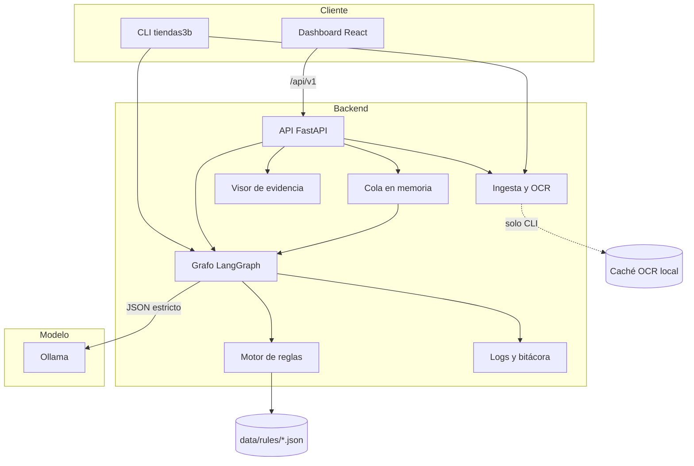
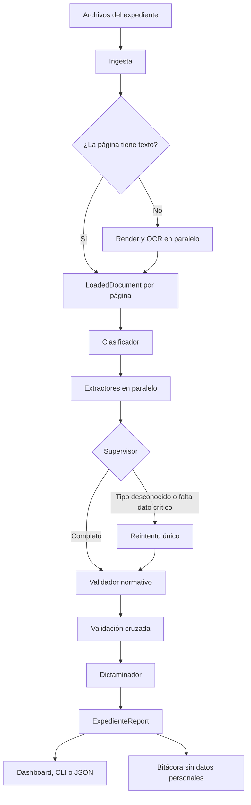
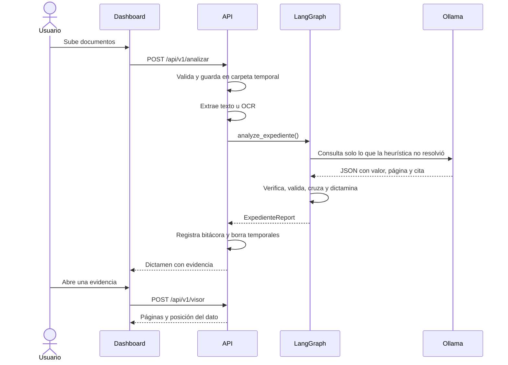
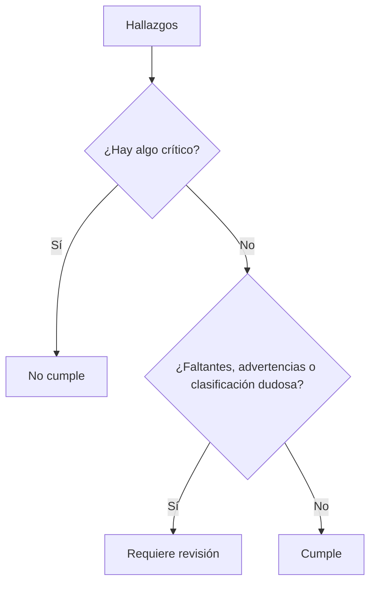

# Tiendas 3B · Análisis multiagente de expedientes

> 🏆 **Primer lugar en la Hackatón Tiendas 3B, "Talento que Hackea el Futuro"** · Reto 1: Expedientes

Sistema multiagente con **LangChain y LangGraph** para hacer la revisión inicial de los expedientes legales de inmuebles candidatos a nueva tienda o centro de distribución. Lee documentos PDF e imágenes, extrae sus datos con evidencia, valida requisitos, contrasta los documentos entre sí y emite una recomendación explicable:

**`Cumple`** · **`Requiere revisión`** · **`No cumple`**

No sustituye la decisión del equipo legal ni constituye un dictamen jurídico. Ayuda a detectar temprano posibles incumplimientos y a concentrar la revisión humana donde hace falta criterio profesional.

## Contenido

1. [El problema](#el-problema)
2. [Qué hace el sistema](#qué-hace-el-sistema)
3. [Tecnologías](#tecnologías)
4. [Arquitectura](#arquitectura)
5. [Flujo de datos](#flujo-de-datos)
6. [Los agentes por dentro](#los-agentes-por-dentro)
7. [Motor de reglas](#motor-de-reglas)
8. [Cómo se calcula el dictamen](#cómo-se-calcula-el-dictamen)
9. [Instalación y ejecución](#instalación-y-ejecución)
10. [Configuración](#configuración)
11. [CLI](#cli)
12. [API](#api)
13. [Dashboard](#dashboard)
14. [Evaluación y calidad](#evaluación-y-calidad)
15. [Estructura del repositorio](#estructura-del-repositorio)
16. [Privacidad y seguridad](#privacidad-y-seguridad)
17. [Limitaciones conocidas](#limitaciones-conocidas)
18. [Documentación adicional](#documentación-adicional)
19. [Equipo](#equipo)

## El problema

Para abrir una tienda o centro de distribución, el equipo legal debe revisar la documentación del inmueble: leer cada documento, localizar datos, validar requisitos y comprobar que todos hablen del mismo predio. Es un trabajo manual, lento y limitado por el tiempo de personal especializado.

Este proyecto automatiza esa primera pasada. El resultado no es solo un veredicto: cada hallazgo indica qué documento lo sustenta, en qué página y con qué fragmento, para que una persona lo verifique en segundos.

## Qué hace el sistema

Cada expediente espera cuatro tipos de documento:

| Documento | Datos que extrae |
| :--- | :--- |
| **Escrituras** | Propietario, dirección, superficie, datos del inmueble y referencia cruzada |
| **Predial** | Propietario, dirección, cuenta o clave, superficie, referencia cruzada y fecha |
| **Alineamiento y Número Oficial** | Dirección oficial, número oficial, predio, alineamiento, fecha y autoridad |
| **Uso de Suelo** | Dirección, uso autorizado, compatibilidad comercial, restricciones, superficie, fecha y autoridad |

Formatos admitidos: **PDF, PNG, JPG/JPEG y TIFF**.

| Recomendación | Interpretación |
| :--- | :--- |
| **Cumple** | Las validaciones implementadas no encontraron fallas que impidan continuar. |
| **Requiere revisión** | Hay faltantes, advertencias, dudas de clasificación o datos que necesitan criterio humano. |
| **No cumple** | Se detectó una regla o discrepancia crítica que debe atenderse antes de continuar. |

## Tecnologías

| Capa | Tecnología | Para qué se usa |
| :--- | :--- | :--- |
| **Orquestación** | LangGraph | Grafo de agentes, estado compartido y reintento condicional |
| **LLM** | LangChain, Ollama, Llama (`llama3.1:8b` por defecto) | Clasificación dudosa y extracción en JSON, con el modelo en infraestructura propia |
| **Proveedor opcional** | `langchain-openai` | Alternativa desactivada por defecto; requiere autorización |
| **Documentos** | PyMuPDF, Pillow | Lectura de PDF, capa de texto y render de páginas |
| **OCR** | Tesseract (`spa`), pytesseract | Lectura de escaneos e imágenes |
| **Comparación** | RapidFuzz | Similitud tolerante a errores de OCR y variaciones de escritura |
| **Validación de datos** | Pydantic | Contratos entre agentes y validación de respuestas del LLM |
| **Backend** | Python 3.11+, FastAPI, Uvicorn | API, carga de archivos y cola de trabajos |
| **Frontend** | React 19, TypeScript, Vite | Dashboard para el equipo legal |
| **Interfaz** | Motion, React Spring, Lucide | Animaciones e iconos |
| **Calidad** | pytest, Ruff, mypy estricto, pip-audit | Pruebas, estilo, tipos y auditoría de dependencias |
| **CI** | GitHub Actions, Dependabot | Validación de cada cambio y actualización de dependencias |

## Arquitectura



Principios de diseño:

- **El LLM propone, el código verifica.** Las citas del modelo se comprueban contra el texto del documento y las decisiones finales salen de reglas deterministas.
- **Funciona sin LLM.** Si el modelo no está configurado, no responde o devuelve JSON inválido, los agentes siguen por su ruta heurística.
- **Reglas como datos.** Los criterios viven en JSON y se pueden ajustar sin modificar el motor.
- **Trazabilidad completa.** El reporte incluye evidencia, reglas evaluadas, cruces y tiempo de cada agente.

## Flujo de datos



Recorrido de una petición desde el dashboard:



### Estructuras principales

Definidas en [`schemas.py`](src/tiendas3b/models/schemas.py):

```text
ExpedienteReport
├── expediente_id, recommendation, confidence, explanation, reasons
├── documents_received, missing_document_types
├── document_analyses[]
│   ├── document_name, document_type, classification_confidence
│   ├── extracted_fields[] → name, value, confidence, method, evidence
│   ├── rule_evaluations[] → rule_id, passed, severity, details, evidence
│   └── missing_fields[]
├── cross_validation_issues[] → field_name, severity, documents, values, evidence
├── trace[] → agent, ms, detail
└── processing_ms, llm_mode

Evidence → document_name, page, snippet
```

## Los agentes por dentro

El grafo está en [`orchestrator.py`](src/tiendas3b/agents/orchestrator.py). Cada nodo recibe el estado compartido, agrega su resultado y deja un paso en la traza.

### 1. Ingesta

[`pdf_loader.py`](src/tiendas3b/ingestion/pdf_loader.py) conserva el texto por página. Una página con menos de 25 caracteres se considera escaneo y pasa por OCR a 300 DPI, con varios procesos de Tesseract en paralelo. Desde la CLI, el texto se guarda en una caché identificada por la huella del archivo. Los documentos subidos a la API no usan esa caché.

### 2. Clasificador

[`classifier.py`](src/tiendas3b/agents/classifier.py) puntúa palabras clave en el nombre del archivo, el título y las dos primeras páginas. Con confianza de 0.75 o más no llama al LLM. Si la evidencia es débil o hay empate, el LLM decide, y si nada convence el documento queda como `desconocido`.

### 3. Extractores

[`extractor.py`](src/tiendas3b/agents/extractor.py) combina dos rutas:

1. **Heurística:** busca patrones `Etiqueta: valor` definidos en [`extractor_fields.py`](src/tiendas3b/agents/extractor_fields.py).
2. **LLM:** se consulta solo por los campos no resueltos, excepto en Escrituras, donde siempre se pregunta por todos. Debe responder con valor, página y cita literal.

Cada dato recibe una confianza según su sustento:

| Situación | Confianza |
| :--- | :---: |
| LLM con cita real que contiene el valor | 0.90 |
| Heurística con valor en la misma línea | 0.75 |
| Heurística con valor en la línea siguiente | 0.65 |
| LLM con valor encontrado, sin cita que lo respalde | 0.60 |
| Heurística y LLM discrepan | máximo 0.55 |
| LLM sin respaldo en el documento | 0.30 |

Si ambas rutas coinciden, la confianza sube 0.07, hasta un máximo de 0.97. Un dato por debajo de `MIN_FIELD_CONFIDENCE` (0.6) cuenta como dudoso.

### 4. Supervisor

Si un documento quedó `desconocido` o le falta un campo crítico, lo manda **una sola vez** a reintento: reclasifica leyendo todo el documento y vuelve a extraer con una estrategia más amplia. Conserva el valor de mayor confianza de cada campo.

### 5. Validador normativo

[`validator.py`](src/tiendas3b/agents/validator.py) evalúa cada documento contra el cartucho de reglas de su tipo.

### 6. Validación cruzada

[`cross_validator.py`](src/tiendas3b/agents/cross_validator.py) compara el mismo dato entre documentos:

| Cruce | Documentos | Criterio | Severidad |
| :--- | :--- | :--- | :--- |
| **Propietario** | Escrituras, Predial | Similitud mínima de 85 % | Advertencia; crítica debajo de 50 % |
| **Dirección** | Los cuatro | Similitud mínima de 80 % | Advertencia |
| **Superficie** | Escrituras, Predial, Uso de Suelo | Diferencia máxima de 5 % | Advertencia |
| **Clave del predio** | Predial, Alineamiento | Identificador normalizado | Advertencia |
| **Número oficial** | Alineamiento contra direcciones | Identificador normalizado | Advertencia |
| **Mismo inmueble** | Los involucrados | Fallan dirección y clave a la vez | **Crítica** |

### 7. Dictaminador

[`synthesizer.py`](src/tiendas3b/agents/synthesizer.py) consolida los hallazgos, calcula la confianza y redacta las razones en lenguaje claro.

## Motor de reglas

Las reglas están en [`data/rules/`](data/rules/README.md), con un archivo por tipo de documento. Actualmente hay **32 reglas definidas y 30 activas**.

```json
{
  "id": "USO-80",
  "tipo": "contiene_alguno",
  "campo": "uso_autorizado",
  "severidad": "warning",
  "activa": true,
  "parametros": {"valores": ["comercial", "servicios"]},
  "descripcion": "El uso autorizado incluye comercio o servicios."
}
```

| Tipo de regla | Pasa cuando |
| :--- | :--- |
| `campo_presente` | El dato existe con confianza suficiente |
| `numero_positivo` | El dato contiene un número mayor a cero |
| `contiene_alguno` | El dato menciona al menos un término |
| `no_contiene` | El dato no menciona ningún término prohibido |
| `alerta_si_presente` | No hay condicionantes relevantes |
| `fecha_vigente` | La fecha más su vigencia no ha vencido |
| `fecha_anio_actual` | La fecha corresponde al año en curso o declara una vigencia activa |
| `anio_permitido` | El año del documento está en la lista permitida |

| Severidad | Efecto |
| :--- | :--- |
| `critical` | **No cumple** |
| `warning` | **Requiere revisión** |
| `info` | Nota que no cambia el veredicto |

Para agregar una regla con un tipo existente basta editar el JSON. Un tipo nuevo requiere una función en `RULE_TYPES` dentro de [`engine.py`](src/tiendas3b/rules/engine.py) y su prueba.

## Cómo se calcula el dictamen



La confianza parte de `calidad`, el promedio entre la confianza media de los campos y la de clasificación:

| Recomendación | Fórmula |
| :--- | :--- |
| No cumple | `0.60 + 0.35 × calidad` |
| Requiere revisión | `0.50 + 0.35 × calidad` |
| Cumple | `mín(0.95, 0.40 + 0.55 × calidad)` |

Es una señal del respaldo de la extracción, **no una probabilidad de validez legal**.

## Instalación y ejecución

### Requisitos

- **Python 3.11** (CI también valida 3.12).
- **Node.js 20 o posterior** y npm para el dashboard.
- **Tesseract** con idioma español para documentos escaneados. `make setup` instala sus dependencias Python, pero no el ejecutable del sistema.
- **Ollama** solo si se quiere usar un modelo local.

### Backend

```bash
make setup     # crea .venv, instala backend, pruebas y OCR; copia .env.example a .env
make ejemplo   # analiza un caso ficticio, sin LLM ni documentos reales
make api       # API en http://127.0.0.1:8000, documentación en /docs
```

### Dashboard

En otra terminal:

```bash
cd frontend
npm ci
npm run dev
```

Abre http://localhost:5173. Vite redirige `/api` al backend. Si la API usa otro puerto:

```bash
API_URL=http://localhost:8001 npm run dev
```

### Modelo local

```bash
ollama pull llama3.1:8b
```

En `.env`:

```dotenv
LLM_PROVIDER=ollama
LLM_MODEL=llama3.1:8b
OLLAMA_BASE_URL=http://localhost:11434
```

Comprueba la conexión con `.venv/bin/tiendas3b estado`. Para compartir el modelo en una red privada, sigue [`docs/AMBIENTE.md`](docs/AMBIENTE.md). Ollama no incluye autenticación, así que no debe exponerse a una red pública.

## Configuración

Todas las variables están en [`.env.example`](.env.example).

| Variable | Default | Descripción |
| :--- | :--- | :--- |
| `LLM_PROVIDER` | `none` | `none`, `ollama` u `openai` |
| `LLM_MODEL` | `llama3.1:8b` | Modelo a usar |
| `LLM_TEMPERATURE` | `0` | Temperatura del modelo |
| `LLM_TIMEOUT_S` | `120` | Tiempo máximo del cliente |
| `LLM_NUM_CTX` | `8192` | Contexto de Ollama |
| `LLM_PARALLEL` | `2` | Documentos enviados al LLM a la vez |
| `LLM_TRACE` | `0` | `0`, `1` o `file`. Puede registrar texto de documentos |
| `OLLAMA_BASE_URL` | `http://localhost:11434` | Servidor de Ollama |
| `RULES_DIR` | `data/rules` | Carpeta de cartuchos |
| `OCR_LANG` | `spa` | Idioma de Tesseract |
| `OCR_DPI` | `300` | Resolución del OCR |
| `OCR_WORKERS` | núcleos, máx. 8 | Páginas simultáneas en OCR |
| `OCR_CACHE` | `1` | Activa la caché de la CLI |
| `OCR_CACHE_DIR` | `data/cache/ocr` | Ubicación de la caché |
| `MIN_FIELD_CONFIDENCE` | `0.6` | Umbral de dato confiable |
| `MAX_WORKERS` | `2` | Análisis simultáneos en la cola |
| `JOB_TTL_S` | `3600` | Caducidad de trabajos terminados |
| `API_KEY` | vacío | Exige el encabezado `X-API-Key` |
| `CORS_ORIGINS` | `*` | Orígenes permitidos |
| `LOG_LEVEL` / `LOG_DIR` | `INFO` / `logs` | Nivel y carpeta de logs |

## CLI

```bash
.venv/bin/tiendas3b ejemplo revision                 # casos: revision, cumple, no_cumple, incompleto
.venv/bin/tiendas3b analizar data/expedientes/ID     # analiza una carpeta
.venv/bin/tiendas3b analizar a.pdf b.pdf --json --salida reporte.json
.venv/bin/tiendas3b agrupar --simular                # propone expedientes sin copiar archivos
.venv/bin/tiendas3b agrupar                          # agrupa documentos en data/expedientes/
.venv/bin/tiendas3b demo-pdfs                        # genera PDFs ficticios
.venv/bin/tiendas3b evaluar --demo                   # mide los casos ficticios
.venv/bin/tiendas3b evaluar --salida resultado.json  # evalúa contra las etiquetas
.venv/bin/tiendas3b diagnostico                      # resume OCR y clasificación
.venv/bin/tiendas3b estado                           # configuración, LLM y reglas
.venv/bin/tiendas3b grafo                            # imprime el diagrama Mermaid
.venv/bin/tiendas3b api --host 127.0.0.1 --puerto 8000
```

`agrupar` une documentos que comparten clave catastral, cuenta, folio o dirección. Es una propuesta automática: revisa siempre el plan con `--simular`.

## API

Documentación interactiva en `/docs`.

| Endpoint | Uso |
| :--- | :--- |
| `GET /api/v1/status` | Estado de la API, del LLM, cartuchos y reglas activas |
| `GET /api/v1/casos` | Casos ficticios disponibles |
| `GET /api/v1/ejemplo?caso=revision` | Ejecuta un caso ficticio |
| `POST /api/v1/analizar` | Analiza un expediente y espera el resultado |
| `POST /api/v1/trabajos` | Encola un análisis (`202 Accepted`) |
| `GET /api/v1/trabajos` | Lista trabajos activos y recientes |
| `GET /api/v1/trabajos/{id}` | Consulta estado, posición y resultado |
| `GET /api/v1/bitacora` | Dictámenes recientes, sin datos del documento |
| `POST /api/v1/visor` | Devuelve páginas y posición de cada evidencia |
| `POST /api/v1/visor/ejemplo` | Igual que el visor, con documentos ficticios |
| `GET /api/v1/grafo` | Diagrama Mermaid del grafo |

Ejemplo:

```bash
curl -X POST http://127.0.0.1:8000/api/v1/analizar \
  -F "expediente_id=EXP-001" \
  -F "usar_llm=true" \
  -F "files=@escritura.pdf" \
  -F "files=@predial.pdf" \
  -F "files=@alineamiento.pdf" \
  -F "files=@uso_de_suelo.pdf"
```

Límites: **40 archivos por expediente y 60 MB por archivo**.

## Dashboard

La aplicación en [`frontend/`](frontend/package.json) permite:

- Gestionar una **bandeja** de expedientes y sus estados.
- Cargar documentos o probar **casos ficticios**.
- Ver el **dictamen**, sus razones y la confianza.
- Revisar datos extraídos y la **matriz documento × regla**.
- **Comparar** valores entre documentos.
- Abrir la **evidencia resaltada** sobre la página original.
- Consultar la **traza** de agentes con sus tiempos.
- Usar tema claro u oscuro.

La bandeja guarda identificadores y resultados en el `localStorage` del navegador. Los archivos solo se conservan en memoria durante la sesión para abrirlos en el visor. Más detalle en [`docs/GUIA_DASHBOARD.md`](docs/GUIA_DASHBOARD.md).

## Evaluación y calidad

`tiendas3b evaluar` compara cada dictamen con [`evaluacion/etiquetas.json`](evaluacion/etiquetas.json) y reporta aciertos, matriz de confusión, recall, confianza, falsos `Cumple` y falsos `No cumple`. La salida JSON contiene solo identificadores y veredictos.

```bash
make check                  # Ruff, formato, mypy y pytest
cd frontend && npm run build
```

Las pruebas cubren reglas, clasificación, extracción, OCR, cruces, orquestación, API, logs y visor. Las que requieren expedientes reales llevan el marcador `real_data` y se omiten por defecto.

GitHub Actions ejecuta lint, formato, tipos y pruebas en Python 3.11 y 3.12, audita dependencias y compila el dashboard con Node.js 20.

## Estructura del repositorio

```text
.
├── src/tiendas3b/
│   ├── agents/
│   │   ├── orchestrator.py      Grafo LangGraph
│   │   ├── classifier.py        Tipo documental
│   │   ├── extractor.py         Extracción y verificación de citas
│   │   ├── extractor_fields.py  Campos, etiquetas y descripciones
│   │   ├── validator.py         Aplicación de reglas
│   │   ├── cross_validator.py   Cruces entre documentos
│   │   └── synthesizer.py       Dictamen
│   ├── api/
│   │   ├── main.py              Endpoints FastAPI
│   │   └── jobs.py              Cola en memoria
│   ├── ingestion/
│   │   ├── pdf_loader.py        PDF, imágenes, OCR y caché
│   │   ├── agrupar.py           Armado de expedientes
│   │   └── diagnostico.py       Diagnóstico de OCR y clasificación
│   ├── models/schemas.py        Contratos Pydantic
│   ├── rules/
│   │   ├── criteria.py          Campos requeridos y cruces
│   │   └── engine.py            Motor de reglas
│   ├── cli.py                   Interfaz de línea de comandos
│   ├── config.py                Variables de entorno
│   ├── demo.py                  Casos ficticios
│   ├── evaluacion.py            Métricas de precisión
│   ├── llm.py                   Capa LLM y JSON estricto
│   ├── logs.py                  Logs, redacción y bitácora
│   ├── text.py                  Normalización y fechas
│   └── visor.py                 Localización de evidencia
├── data/rules/                  Cartuchos JSON
├── evaluacion/                  Etiquetas esperadas
├── frontend/src/                Dashboard
├── docs/                        Arquitectura, ambiente y dashboard
├── pitch/                       Guion y demo
├── estado/                      Bitácoras del equipo
├── tests/                       Pruebas automatizadas
├── .github/                     CI y Dependabot
├── Makefile                     Comandos principales
└── pyproject.toml               Dependencias y herramientas
```

## Privacidad y seguridad

- Los expedientes reales **no se suben al repositorio**. `data/raw/`, `data/expedientes/`, los PDF, los ZIP, los logs y la caché OCR están excluidos de Git.
- La configuración predeterminada no usa LLM. Con Ollama, los documentos solo viajan a la instancia configurada.
- Un proveedor externo solo debe usarse con autorización del comité.
- La API procesa los archivos en carpetas temporales y las elimina al terminar.
- La bitácora guarda veredicto, conteos, tiempos y huella de reglas, sin nombres, direcciones ni citas.
- Los logs redactan los valores extraídos.
- `LLM_TRACE` puede escribir prompts con texto de documentos, por lo que debe permanecer apagado con datos reales.

## Limitaciones conocidas

- Es un **prototipo de apoyo**. Toda recomendación debe ser revisada por el equipo legal.
- La calidad del OCR limita la extracción en escaneos borrosos o de baja resolución.
- Las severidades y varios criterios son provisionales y deben confirmarse contra la guía oficial.
- `PRE-07` tiene los años permitidos fijos (2025 y 2026) y debe actualizarse en cada ejercicio.
- El prompt del extractor se limita a 2,500 caracteres, así que un documento largo puede quedar parcialmente fuera de la consulta al LLM.
- La llamada a Ollama no fija `num_predict`. Conviene definir ese tope en un Modelfile para evitar generaciones excesivas.
- La cola vive en memoria: los trabajos se pierden al reiniciar la API.
- El dashboard todavía no envía `X-API-Key`. Con `API_KEY` definida, sus llamadas responden `401`.

## Documentación adicional

- [Arquitectura y flujo de agentes](docs/ARCHITECTURE.md)
- [Instalación, OCR y conexión con Ollama](docs/AMBIENTE.md)
- [Guía del dashboard y datos de la API](docs/GUIA_DASHBOARD.md)
- [Formato y severidad de las reglas](data/rules/README.md)
- [Guion de demostración](pitch/DEMO.md)

## Equipo

**Aaron · Andrés · Carlos · Diego · Víctor**
