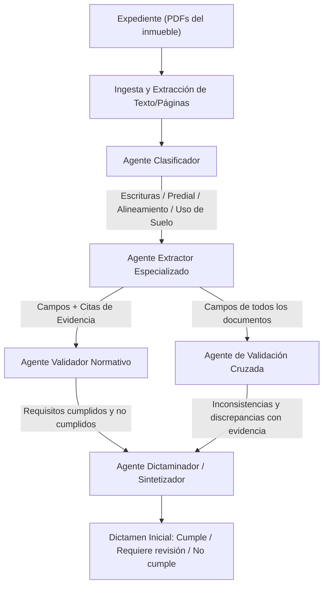

# Arquitectura Multiagente — Reto 1 · Expedientes

## Flujo de Agentes (LangChain / LangGraph)

## Responsabilidades por Agente

1. **Agente Clasificador (`classifier.py`)**: Identifica automáticamente el tipo documental de cada archivo recibido (`Escrituras`, `Predial`, `Alineamiento y Número Oficial`, `Uso de Suelo` o `Desconocido`) y detecta documentos faltantes.
2. **Agente Extractor (`extractor.py`)**: Extrae los campos requeridos por tipo documental junto con la referencia exacta (documento, página y fragmento de texto).
3. **Agente Validador Normativo (`validator.py`)**: Evalúa cada documento contra los criterios y reglas definitivas del reto.
4. **Agente de Validación Cruzada (`cross_validator.py`)**: Contrasta datos clave entre documentos del mismo expediente (dirección, propietario/titular, superficie, número oficial y clave predial).
5. **Agente Dictaminador (`synthesizer.py`)**: Consolida hallazgos, calcula nivel de confianza, redacta la explicación para el equipo legal y emite la recomendación inicial (`Cumple`, `Requiere revisión` o `No cumple`).
